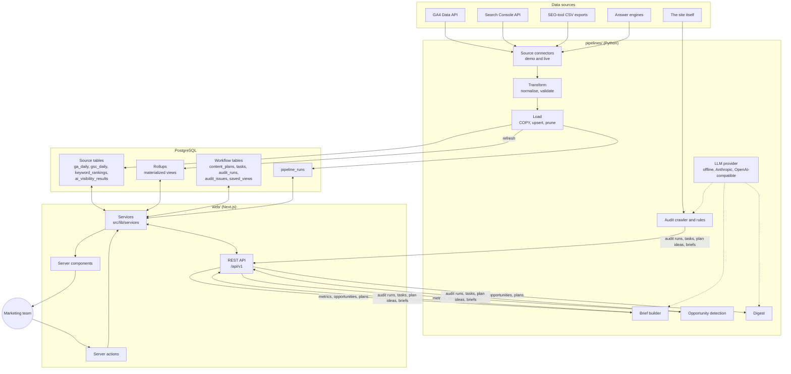

# Architecture

The platform has three parts that meet in one PostgreSQL database:

- `pipelines/`: a Python package that loads data and runs the automation
  scripts, driven by the `map` command.
- `web/`: a Next.js application that serves the UI and the REST API.
- `db/migrations/`: the schema both of them use.



## Who writes what

| Tables | Written by | How |
| --- | --- | --- |
| `pages`, `ga_daily`, `gsc_daily`, `keywords`, `keyword_rankings`, `domain_metrics_daily`, `ai_prompts`, `ai_visibility_results`, `pipeline_runs`, the rollups | pipelines | SQL: `COPY` into a temporary table, then `INSERT ... ON CONFLICT DO UPDATE` |
| `content_plans`, `tasks`, `audit_runs`, `audit_issues`, `saved_views` | web app | Services, called from server actions and REST handlers |
| The same workflow tables, on behalf of automation | scripts | REST API with a bearer token |

The scripts never write workflow rows with SQL. Going through the API means
they get the same validation, deduplication and ordering rules as the UI, and
the web app stays the one place that knows how those tables behave. The one
exception is `map seed-demo`, which inserts the demo workspace directly so the
demo can be loaded before the web app is running.

## The schema has one definition

The SQL files in `db/migrations` are the schema. `map migrate` applies them in
order inside a transaction each, records name and checksum in
`schema_migrations`, and refuses to continue if an applied file has since been
edited. An advisory lock stops two migrators running at once.

The web app does not create or alter tables. It mirrors them in a
hand-written Drizzle schema (`web/src/db/schema.ts`) to get typed queries. A
test (`web/src/db/schema-drift.test.ts`) applies the migrations to a scratch
database and compares every table's columns, types and nullability with the
Drizzle definitions, so the mirror cannot drift unnoticed.

## Pipelines

Each pipeline is a `Source` plus a transform and a load.

- **Sources** (`sources/`) come in two kinds behind one protocol. Live sources
  call the upstream API. Demo sources generate rows shaped exactly like the
  upstream response: GA4 dates as `YYYYMMDD`, Search Console rows with a `keys`
  array, alpha-3 country codes and upper-case device names. Everything after
  the source is therefore the same code in both modes.
- **Transforms** (`transform/`, `etl/transforms.py`) normalise URLs to one
  canonical form so GA4 paths, Search Console URLs and SEO-tool URLs join on
  the same page, map countries and devices to one vocabulary, classify brand
  queries, and validate each row with pydantic. Rows that fail validation are
  counted and skipped; they do not fail the run.
- **Loads** (`etl/load.py`) stage a batch with `COPY`, merge it on the table's
  natural key, and delete rows for the staged dates that the source no longer
  reports. Re-running any window is therefore idempotent and also picks up
  upstream corrections. An empty pull never deletes anything.
- **The runner** (`etl/runner.py`) splits long windows into 14-day chunks,
  retries transient failures with exponential backoff, refreshes the rollups
  with `REFRESH MATERIALIZED VIEW CONCURRENTLY`, and records every run in
  `pipeline_runs` with its window, row count and error.

The default window is the last three days, because both GA4 and Search Console
revise recent days after first reporting them.

Details per connector are in [pipelines.md](pipelines.md).

## Web application

```text
src/app/                 routes: pages (server components) and /api/v1 handlers
src/lib/services/        every query and mutation, returning plain resource objects
src/lib/filters/         one Zod schema per report: URL parsing, serialising, SQL conditions
src/lib/api/             REST plumbing: envelope, errors, auth, validation, CSV, OpenAPI
src/lib/actions/         server actions: validate, call a service, revalidate paths
src/components/          UI, charts and the client side of each feature
src/db/                  Drizzle schema mirror and the postgres.js client
```

**Services are the seam.** A page calls `listQueries(filters, periods)`; so
does `GET /api/v1/seo/queries`. Services return snake_case resource objects, so
the REST handler passes them through and the UI reads the same field names
that are in the API reference.

**Filters are defined once.** `src/lib/filters/seo.ts` holds a Zod schema for
the SEO report's state. The page parses the URL with it leniently (an invalid
parameter falls back to its default instead of breaking a bookmarked link),
the API parses the query string with it strictly (an invalid parameter is a
400), and the same schema serialises state back into a URL, leaving out
defaults so links stay short. `src/lib/filters/sql.ts` turns the parsed state
into SQL conditions.

**SQL safety.** Aggregations are written as SQL through Drizzle's `sql`
template, which binds every interpolated value as a parameter. Sort columns
are looked up in a per-report allowlist of SQL fragments; an unknown sort key
falls back to the default and can never reach the query text.

**Reads go to rollups where possible.** The SEO report reads
`mv_search_page_daily` unless a filter needs query text, in which case it
reads `gsc_daily`. The overview and the AI-visibility report read
`mv_traffic_daily` and `mv_ai_visibility_daily`.

**Mutations from the UI** are server actions. Each one validates its input
with the same Zod schema the API uses, calls the service, and revalidates the
affected paths. The board applies a drag immediately and rolls the card back
if the action fails.

**The REST API** wraps each handler in `route()` (`src/lib/api/handler.ts`),
which checks the bearer token on non-GET requests (and on reads when
`API_REQUIRE_TOKEN_FOR_READS=true`), turns Zod failures into 400 responses and
unknown errors into a 500 without leaking details. The token is compared in
constant time. `GET /api/v1/openapi.json` is generated from the same Zod
schemas, and a test checks that every route file is described there.

## The automation loop

The scripts turn what the data shows into work for the team, and each one is a
round trip through the API:

| Script | Reads | Writes |
| --- | --- | --- |
| `map audit` | the site, by crawling it | `POST /audits` with the run and its issues, then `POST /tasks` for critical and high issues |
| `map briefs` | `GET /plans?brief_status=requested`, `GET /seo/queries`, `GET /seo/keywords`, `GET /seo/pages` | `PUT /plans/{id}/brief` |
| `map opportunities` | `GET /seo/opportunities` for each type | `POST /tasks` and `POST /plans`, each with a dedupe key |
| `map digest` | `GET /metrics/overview`, `GET /seo/pages`, `GET /audits/latest`, `GET /ai-visibility/summary` | a Markdown file |

Three of them produce prose: the audit summary, the brief and the digest
narrative. `llm/structured.py` handles that the same way each time: build the
facts deterministically, ask the configured provider to write them up as JSON
matching a pydantic schema, validate the reply, ask once more with the
validation error if it fails, and fall back to a rule-based version otherwise.
With `LLM_PROVIDER=offline` the rule-based version is used directly, which is
how the tests and the demo run without network access. Each stored result
records whether a model or the rules wrote it.

## Deployment shape

- `web/Dockerfile` builds Next.js in standalone mode and runs it as a non-root
  user. The app needs `DATABASE_URL` and `API_TOKEN`.
- `pipelines/Dockerfile` packages the CLI together with the migrations and the
  demo site.
- `docker-compose.yml` runs PostgreSQL, a one-shot service that migrates and
  seeds, and the web app; the CLI and the demo site are behind the `tools`
  profile.
- Pipelines are batch jobs. Run `map run all --mode live` from any scheduler;
  `.github/workflows/pipelines.yml` is a scheduled GitHub Actions example.

There is no authentication layer in the app itself. See the limitations in the
[README](../README.md#limitations).
