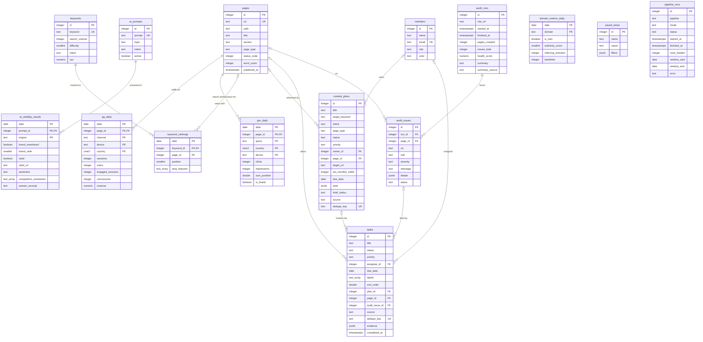

# Data model

The schema is defined by the SQL files in `db/migrations` and applied with
`map migrate`. This page describes what is in it and why it is shaped the way
it is.

| Migration | Contents |
| --- | --- |
| `0001_core.sql` | `pages`, `members`, `pipeline_runs`, the `pg_trgm` extension, the `set_updated_at()` trigger function |
| `0002_sources.sql` | tables loaded by the pipelines |
| `0003_workflow.sql` | tables owned by the web app |
| `0004_rollups.sql` | materialized views behind the dashboards |

`schema_migrations (version, checksum, applied_at)` is created by the migration
runner itself.

## Entity relationships



## Reference tables

### `pages`

One row per canonical URL of the tracked site. Every source that mentions a
URL upserts it here first, after normalising it (lower-case host and path, no
tracking parameters, trailing slash on directory paths), so that GA4, Search
Console and the SEO tool all point at the same `page_id`.

`section` and `page_type` are derived from the path by rules in
`transform/classify.py`. `title`, `word_count` and `status_code` are filled in
by whichever source knows them (the audit crawler, mostly); a source that does
not carry a value leaves the existing one alone.

### `members`

The people plans and tasks can be assigned to. There are no accounts or
passwords: this is a lookup table, not an authentication table.

### `pipeline_runs`

One row per pipeline execution: which pipeline, demo or live, the date window,
status, rows loaded, and the error if it failed. The Pipelines page and the
"Demo data" marker read it.

## Source tables

All four fact tables have a natural primary key, which is what makes loads
idempotent: loading the same day twice updates rows in place.

### `ga_daily`

Sessions, users, engaged sessions, conversions and revenue per day, page,
channel group, device and country.

### `gsc_daily`

Clicks, impressions and position per day, page, query, country and device.

Position is stored as `sum_position`, the average position multiplied by
impressions. Average position cannot be averaged again, but an
impression-weighted sum can be added up, so at any grain:

```sql
avg_position = sum(sum_position) / nullif(sum(impressions), 0)
```

`is_brand` is set at load time from `BRAND_QUERY_PATTERN`. A trigram index on
`query` keeps "contains" filters fast.

### `keywords` and `keyword_rankings`

`keywords` holds each tracked keyword with its volume, difficulty, intent and
CPC. `keyword_rankings` is the daily snapshot: position (NULL when the site was
not found in the tracked depth), the ranking page and the SERP features seen.

### `domain_metrics_daily`

Authority score, referring domains and backlinks per day for the site and its
competitors.

### `ai_prompts` and `ai_visibility_results`

`ai_prompts` is the list of questions put to the answer engines; a prompt can
be retired by setting `active = false` without losing its history.

`ai_visibility_results` has one row per day, prompt and engine, holding what
the mention parser found in the answer: whether the brand was named, its rank
among the tracked brands (1 = named first), whether a URL on the site was
cited, the tone around the brand, which competitors were named, and an excerpt
of the answer. Check constraints keep the row consistent: no rank without a
mention, no cited URL without a citation.

## Workflow tables

### `content_plans`

A page to create or refresh. `status` moves through `idea`, `brief`, `draft`,
`review`, `scheduled`, `published`. `page_id` is set when the plan refreshes an
existing page, which lets the planner show that page's current metrics.

The brief lives in `brief` as JSON and `brief_status` tracks it: `none`,
`requested` (set in the UI, picked up by `map briefs`), `ready` or `failed`.
A partial index on `brief_status = 'requested'` serves that lookup.

### `tasks`

A unit of work on the board. `sort_order` is a floating-point position within
a status column: moving a card writes one row, with a value halfway between
its new neighbours. When neighbours get too close the column is renumbered.

`plan_id`, `page_id` and `audit_issue_id` link a task to what it is about, and
`evidence` holds the numbers that justified opening it. `completed_at` is set
when a task enters `done` and cleared when it leaves.

### `dedupe_key` on plans and tasks

Automation sets a stable key on what it creates, for example
`audit:title_missing:https://www.northpeak.example/stores/boulder/` or
`opportunity:striking:hiking backpacks`. The column is unique, and creation
uses `ON CONFLICT DO NOTHING`, so running a script again returns the existing
record instead of opening a duplicate, even after the original was edited or
completed.

### `audit_runs` and `audit_issues`

A run stores the crawl's totals, health score and summary. Issues belong to a
run and are unique per `(run_id, rule, url)`. An issue's `status` is `open`,
`ignored` or `fixed`; when a new run reports the same rule on the same URL,
an `ignored` status is carried over so triage does not have to be repeated.

### `saved_views`

A named set of report filters, stored as JSON and unique per report. The
filters are re-validated when a view is loaded, so a stored view survives
changes to the filter schema.

## Rollups

Materialized views keep the dashboards off the large tables. Each has a unique
index so the pipelines can refresh it with
`REFRESH MATERIALIZED VIEW CONCURRENTLY`, which does not block readers.

| View | Grain | Read by |
| --- | --- | --- |
| `mv_traffic_daily` | date, section, channel, device, country | Overview KPIs, trend and channel split |
| `mv_search_page_daily` | date, page, country, device, brand flag | SEO report and search KPIs whenever no query-text filter is active |
| `mv_ai_visibility_daily` | date, engine, topic | AI-visibility score, rates and trends |

`mv_ai_visibility_daily` stores counts by rank bucket (`rank_1`, `rank_2`,
`rank_3`, `rank_4_plus`) so the visibility score can be computed from the
rollup alone:

```text
score = 100 * (0.70*rank_1 + 0.50*rank_2 + 0.35*rank_3 + 0.25*rank_4_plus + 0.30*cited) / checks
```

An answer that names the brand first and cites the site scores 100; an answer
that does not mention it scores 0.

## Conventions

- **Enumerations are `text` with `CHECK` constraints**, not PostgreSQL enum
  types. Adding a value is a one-line migration, and the same lists live in
  `web/src/lib/domain.ts` and `pipelines/src/map_pipelines/models.py`.
- **Countries are ISO 3166-1 alpha-2**, upper case; `ZZ` means unknown.
  Devices are `desktop`, `mobile` or `tablet`.
- **Dates are the source's reporting dates.** Timestamps are `timestamptz`.
- **Foreign keys to `pages` and `members` from workflow tables use
  `ON DELETE SET NULL`**, so deleting a page or a member never deletes work.
  Fact rows cascade with their page.
